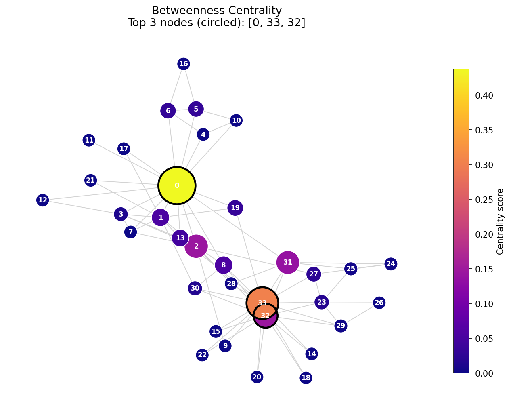

# Social Network Analysis: Centrality Metrics on Zachary's Karate Club

A group project that applies the **core centrality metrics of Social Network Analysis (SNA)** to the classic *Zachary's Karate Club* network, using Python and NetworkX. The project identifies the most influential members of the club and visualises every metric as a network graph.

## Project Topic
**Social Network Analysis Metrics: Core Centrality Metrics**

| # | Metric | What it measures |
|---|--------|------------------|
| a | **Degree Centrality** | Number of direct connections a node has. In directed networks it splits into in-degree (popularity) and out-degree (activity). |
| b | **Closeness Centrality** | How close a node is, on average, to every other node (shortest paths). High closeness = can reach or spread information to the whole network quickly. |
| c | **Betweenness Centrality** | How often a node lies on the shortest path between other pairs of nodes. High scores = bridges / gatekeepers between clusters. |
| d | **Eigenvector Centrality** | Scores a node higher when it is connected to other high-scoring nodes. PageRank is a famous variant (included here as a bonus). |

## Dataset
**Zachary's Karate Club**: 34 members of a university karate club and 78 friendships (undirected, unweighted). The club split into two factions after a dispute between the instructor (**Node 0, "Mr. Hi"**) and the president (**Node 33, "Officer"**).

* Source: [Network Repository: soc-karate](https://networkrepository.com/soc-karate.php)
* Loaded directly with `nx.karate_club_graph()`, so no download is needed.

## References
* [Fundamentals of Social Network Analysis (SNA): Kaggle](https://www.kaggle.com/code/mexwell/fundamentals-of-social-network-analysis-sna)
* [Zachary's Karate Club: Network Repository](https://networkrepository.com/soc-karate.php)

## Using a Different (Social Media) Dataset
The centrality code works on **any network**, not just the Karate Club. In the first code cell set:
```python
EDGE_FILE = "facebook_combined.txt"   # any edge list: one "node1 node2" pair per line
```
Free social-network datasets: [SNAP (Stanford)](https://snap.stanford.edu/data/) e.g. *ego-Facebook*, [Network Repository](https://networkrepository.com/), [Kaggle Datasets](https://www.kaggle.com/datasets). Everything else (metrics, graphs, charts) runs unchanged. For networks over 2,000 nodes betweenness is sampled so it finishes quickly.

## What the Notebook Does
1. Loads the graph (Karate Club by default, or your own edge list) and prints basic info (nodes, edges, density, clustering).
2. Computes Degree, Closeness, Betweenness, Eigenvector centrality (+ PageRank).
3. Combines all scores into one table and saves it as `centrality_results.csv`.
4. Draws a **separate network graph for every centrality** (node colour and size = score, top 3 circled).
5. Draws top-10 bar charts, a 2x2 overview, and a heatmap/correlation of all metrics.
6. Compares the two leaders (Node 0 vs Node 33) and states the conclusions.

## Key Results
| Metric | Top node | Score |
|--------|----------|-------|
| Degree | 33 | 0.5152 |
| Closeness | 0 | 0.5690 |
| Betweenness | 0 | 0.4376 |
| Eigenvector | 33 | 0.3734 |
| PageRank (bonus) | 33 | 0.0970 |

**Interpretation**
* **Node 33 (Officer)** has the most friends (degree) and the most *well-connected* friends (eigenvector).
* **Node 0 (Mr. Hi)** is closest to everyone (closeness) and is the main bridge between groups (betweenness).
* Nodes **32** and **2** are strong secondary hubs.
* The two leaders dominate all rankings, matching the real-life split of the club into two factions.

## Output Graphs
| Graph | File |
|-------|------|
| Degree network | `figures/1_degree_network.png` |
| Closeness network | `figures/2_closeness_network.png` |
| Betweenness network | `figures/3_betweenness_network.png` |
| Eigenvector network | `figures/4_eigenvector_network.png` |
| PageRank network (bonus) | `figures/5_pagerank_network.png` |
| Top-10 bar charts | `figures/6_top10_bar_charts.png` |
| 2x2 overview | `figures/7_overview_2x2.png` |
| Heatmap | `figures/8_heatmap.png` |



## Repository Structure
```
.
├── TEAM_PROJECT.ipynb       # main notebook (all code + explanations)
├── centrality_results.csv   # centrality scores for all 34 nodes
├── figures/                 # saved graphs (PNG)
├── requirements.txt
├── .gitignore
└── README.md
```

## How to Run
```bash
git clone <YOUR-REPO-URL>
cd <repo-folder>
pip install -r requirements.txt
jupyter notebook TEAM_PROJECT.ipynb
```
Then choose **Kernel → Restart & Run All**. Graphs are saved automatically in `figures/`.

## Tech Stack
Python 3 · NetworkX · Pandas · Matplotlib · SciPy · Jupyter Notebook


## License
For academic / educational use.
